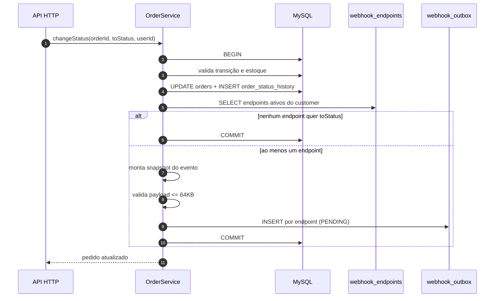
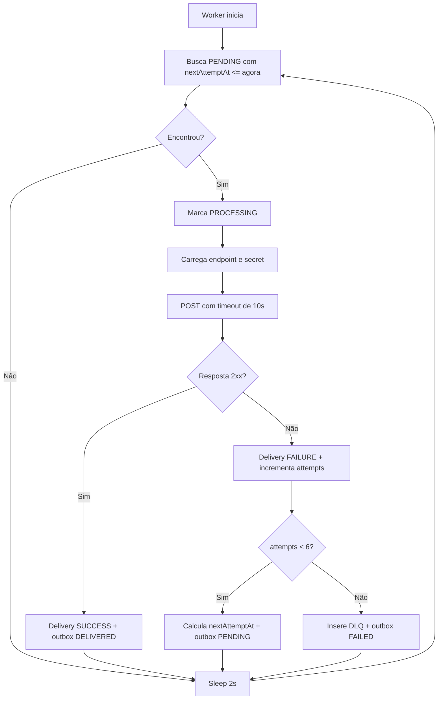
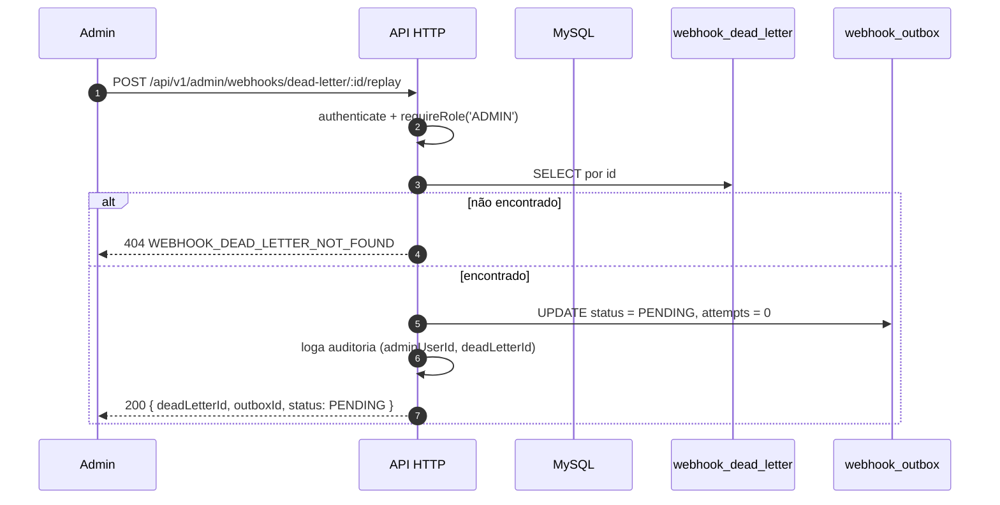

# FDD — Sistema de Webhooks de Notificação de Pedidos

| Campo | Valor |
|---|---|
| **Feature** | Sistema de Webhooks de Notificação de Pedidos |
| **Status** | Proposto — aguardando revisão do time |
| **Autoria** | Arquitetura de Software / Tech Lead |
| **Data** | 2026-11-21 |
| **Documentos relacionados** | [RFC](./RFC.md) · [ADR-001](./adrs/ADR-001-outbox-transacional-no-mysql.md) · [ADR-002](./adrs/ADR-002-worker-separado-em-polling.md) · [ADR-003](./adrs/ADR-003-politica-de-retry-backoff-e-dlq.md) · [ADR-004](./adrs/ADR-004-autenticacao-hmac-sha256-e-rotacao-de-secret.md) · [ADR-005](./adrs/ADR-005-entrega-at-least-once-e-idempotencia-via-event-id.md) · [ADR-006](./adrs/ADR-006-reuso-dos-padroes-arquiteturais-existentes.md) · [ADR-007](./adrs/ADR-007-snapshot-de-payload-na-insercao-da-outbox.md) |

## 1. Contexto e Motivação Técnica

Atlas Comercial, MaxDistribuição e Nova Cargo são clientes B2B que hoje fazem polling no `GET /orders` para descobrir se o status dos pedidos mudou; a integração ficou lenta e cara para eles ([09:00] Marcos). Para esses clientes, qualquer latência abaixo de 10 segundos já é considerada “tempo real” ([09:02] Marcos). A Atlas sinalizou que pode migrar para o concorrente caso a entrega não ocorra até o fim do trimestre ([09:00] Marcos).

A transação de mudança de status já é pesada: atualiza `orders`, insere em `order_status_history` e decrementa `stock_quantity` dos produtos do pedido ([09:04] Bruno). Um disparo HTTP síncrono dentro dessa transação faria um cliente lento bloquear a mudança de status de outros pedidos, e não é aceitável dar rollback na mudança de status caso o cliente esteja fora do ar ([09:04] Bruno; [09:05] Diego). A solução adotada é o padrão outbox: gravar o evento na `webhook_outbox` dentro da mesma transação SQL e deixar um worker separado disparar as chamadas HTTP ([09:06] Diego; [09:08] Larissa).

Este FDD detalha a implementação das decisões registradas no [RFC](./RFC.md) e nos ADRs. O ponto de integração central é `OrderService.changeStatus` em `src/modules/orders/order.service.ts` (L126–179), que já abre `this.prisma.$transaction` (L131) e possui o tipo `TxClient = Prisma.TransactionClient` (L24). A API é inicializada por `src/server.ts`, e o projeto já expõe o factory `createPrismaClient()` em `src/config/database.ts` (L4–8).

## 2. Objetivos Técnicos

- **Consistência transacional:** garantir que uma mudança de status commitada tenha o evento registrado na outbox, e que um rollback da transação remova o evento junto ([09:06] Diego; [09:40] Bruno).
- **Latência de entrega:** usar polling de 2 segundos no worker, atendendo à percepção de “tempo real” abaixo de 10 segundos ([09:09] Diego; [09:10] Larissa; [09:10] Marcos).
- **Isolamento de falhas:** manter o cliente lento ou indisponível fora do caminho transacional de pedidos, sem bloquear a API ([09:04] Bruno).
- **Confiabilidade:** entrega at-least-once com idempotência via `X-Event-Id`, retry com backoff e DLQ ([09:24] Diego; [09:15] Diego; [09:17] Larissa).
- **Segurança:** HMAC-SHA256 com secret por endpoint, rotação com grace period de 24h e HTTPS obrigatório ([09:19] Sofia; [09:22] Sofia; [09:23] Sofia).
- **Observabilidade:** reutilizar Pino, registrar auditoria de replay e acompanhar métricas operacionais de fila, entrega, retry e DLQ ([09:29] Bruno; [09:36] Sofia).
- **Compatibilidade:** reutilizar os padrões existentes de módulos, erros, validação, autenticação e schema Prisma ([09:30] Larissa).

## 3. Escopo e Exclusões

### 3.1 Incluído nesta entrega

- Cadastro, edição, remoção e listagem de webhooks por customer, com lista de status de interesse e estado ativo ([09:31] Marcos; [09:33] Bruno; [09:21] Bruno).
- Rotação de secret por endpoint, com a secret anterior válida por 24 horas em paralelo ([09:21] Sofia).
- Outbox transacional `webhook_outbox` alimentada dentro de `OrderService.changeStatus` ([09:06] Diego; [09:40] Bruno).
- Worker separado em polling de 2 segundos, com single-worker nesta fase ([09:09] Diego; [09:10] Larissa; [09:12] Diego).
- Retry com backoff 1m/5m/30m/2h/12h, timeout de 10s e DLQ em `webhook_dead_letter` ([09:15] Diego; [09:17] Larissa; [09:18] Diego; [09:42] Diego).
- Replay manual de DLQ por endpoint administrativo, restrito a `ADMIN`, com auditoria ([09:18] Diego; [09:36] Sofia).
- Entrega at-least-once com `X-Event-Id` e deduplicação pelo cliente ([09:24] Diego; [09:25] Diego).
- HMAC-SHA256, HTTPS e limite de payload de 64KB sem truncamento ([09:20] Sofia; [09:23] Sofia; [09:24] Larissa).
- Snapshot do payload no momento da inserção na outbox ([09:52] Larissa).
- Histórico de entregas por webhook, com os últimos 100 envios ([09:34] Marcos).
- Logs Pino, auditoria de replay e métricas operacionais recomendadas.

### 3.2 Excluído ou adiado

- **Webhooks inbound:** somente outbound, da plataforma para o cliente ([09:02] Marcos; [09:03] Sofia).
- **Email de alerta:** fora do escopo desta fase ([09:37] Larissa).
- **Dashboard visual:** não nesta fase; painel é projeto separado do frontend ([09:39] Marcos; [09:40] Larissa).
- **Arquivamento automático de linhas entregues após 30 dias:** explicitamente fora do escopo desta feature ([09:08] Diego).
- **Rate limiting de envio:** não implementado nesta fase; observar e decidir depois ([09:38] Diego; [09:39] Larissa).
- **Múltiplos workers, particionamento por `order_id` e lock pessimista:** adiados; operação single-worker nesta fase ([09:12] Diego; [09:13] Diego).
- **Garantia exactly-once:** descartada; a entrega é at-least-once ([09:25] Diego).
- **Retry com 3 tentativas ou indefinido:** descartados em favor de 5 retries com backoff e teto ([09:15] Diego; [09:16] Diego).
- **Truncamento de payload acima de 64KB:** descartado; a operação deve errar ([09:23] Sofia; [09:24] Larissa).
- **Redis Streams/Cluster e trigger SQL:** descartados como mecanismos de fila/notificação ([09:07] Diego; [09:09] Diego).
- **Alterações nas regras de ciclo de vida do pedido ou de estoque:** não fazem parte desta feature.

## 4. Modelagem de Dados (Prisma / MySQL)

A modelagem segue o padrão do projeto: IDs `String @id @default(uuid()) @db.Char(36)`, nomes de modelos em PascalCase, tabelas mapeadas com `@@map`, e charset/collation `utf8mb4` / `utf8mb4_unicode_ci` já aplicado nas migrations MySQL (`prisma/migrations/20260519182739_init/migration.sql`).

```prisma
enum WebhookOutboxStatus {
  PENDING
  PROCESSING
  DELIVERED
  FAILED
}

enum WebhookDeliveryStatus {
  SUCCESS
  FAILURE
}

model WebhookEndpoint {
  id                      String    @id @default(uuid()) @db.Char(36)
  customerId              String    @db.Char(36)
  url                     String    @db.VarChar(2048)
  secret                  String    @db.VarChar(512)
  previousSecret          String?   @db.VarChar(512)
  previousSecretExpiresAt DateTime?
  eventStatuses           Json
  active                  Boolean   @default(true)
  createdAt               DateTime  @default(now())
  updatedAt               DateTime  @updatedAt

  customer    Customer           @relation(fields: [customerId], references: [id], onDelete: Cascade)
  outbox      WebhookOutbox[]
  deliveries  WebhookDelivery[]
  deadLetters WebhookDeadLetter[]

  @@index([customerId, active])
  @@index([active])
  @@map("webhook_endpoints")
}

model WebhookOutbox {
  id            String              @id @default(uuid()) @db.Char(36)
  webhookId     String              @db.Char(36)
  orderId       String              @db.Char(36)
  eventId       String              @db.Char(36)
  payload       Json
  status        WebhookOutboxStatus @default(PENDING)
  attempts      Int                 @default(0)
  nextAttemptAt DateTime?
  lastError     String?             @db.Text
  createdAt     DateTime            @default(now())
  updatedAt     DateTime            @updatedAt

  webhook     WebhookEndpoint    @relation(fields: [webhookId], references: [id], onDelete: Cascade)
  order       Order              @relation(fields: [orderId], references: [id], onDelete: Cascade)
  deliveries  WebhookDelivery[]
  deadLetters WebhookDeadLetter[]

  @@unique([webhookId, eventId])
  @@index([status, createdAt])
  @@index([status, nextAttemptAt])
  @@index([webhookId])
  @@index([eventId])
  @@map("webhook_outbox")
}

model WebhookDeadLetter {
  id            String   @id @default(uuid()) @db.Char(36)
  webhookId     String   @db.Char(36)
  outboxId      String   @db.Char(36)
  eventId       String   @db.Char(36)
  payload       Json
  failureReason String   @db.Text
  attempts      Int
  failedAt      DateTime @default(now())

  webhook WebhookEndpoint @relation(fields: [webhookId], references: [id], onDelete: Cascade)
  outbox  WebhookOutbox   @relation(fields: [outboxId], references: [id], onDelete: Cascade)

  @@index([webhookId])
  @@index([eventId])
  @@index([failedAt])
  @@map("webhook_dead_letter")
}

model WebhookDelivery {
  id             String                @id @default(uuid()) @db.Char(36)
  webhookId      String                @db.Char(36)
  outboxId       String                @db.Char(36)
  eventId        String                @db.Char(36)
  status         WebhookDeliveryStatus
  attemptNumber  Int
  payload        Json
  responseStatus Int?
  responseBody   String?               @db.Text
  responseTimeMs Int
  error          String?               @db.Text
  attemptedAt    DateTime              @default(now())

  webhook WebhookEndpoint @relation(fields: [webhookId], references: [id], onDelete: Cascade)
  outbox  WebhookOutbox   @relation(fields: [outboxId], references: [id], onDelete: Cascade)

  @@index([webhookId, attemptedAt])
  @@index([eventId])
  @@map("webhook_deliveries")
}
```

Relações a adicionar nos modelos existentes:

- `Customer`: `webhookEndpoints WebhookEndpoint[]`.
- `Order`: `webhookOutboxEntries WebhookOutbox[]`.

**Premissas de modelagem:**

- Os nomes `WebhookEndpoint` / `webhook_endpoints` e `WebhookDelivery` / `webhook_deliveries` são propostas deste FDD; a reunião nomeou explicitamente `webhook_outbox` e `webhook_dead_letter` ([09:06] Diego; [09:18] Diego). A tabela de configuração e a de histórico não tiveram nome fechado ([09:21] Bruno/Sofia; [09:34] Marcos).
- O filtro de status é persistido como `eventStatuses Json`, uma lista de valores de `OrderStatus`; a call fala em “lista dos status” sem definir normalização ([09:33] Marcos). O filtro na inserção consulta endpoints ativos do customer e verifica se `toStatus` está na lista.
- A outbox é gravada **uma linha por endpoint interessado**, com o mesmo `eventId` para todos os endpoints do mesmo evento. A call não detalha fan-out para múltiplos webhooks; essa premissa permite retry e DLQ independentes por endpoint e mantém `X-Webhook-Id` inequívoco.
- `attempts` conta chamadas HTTP já realizadas; `nextAttemptAt` controla o próximo retry; `lastError` guarda o último motivo de falha. A call define a política de retry, mas não as colunas de controle.
- O histórico de entregas grava uma linha por tentativa HTTP (`WebhookDelivery`), com payload snapshot, status, response HTTP, tempo de resposta e erro. A call pede “sucesso/falha, payload, response, tempo de resposta” ([09:34] Marcos), sem definir a granularidade; a granularidade por tentativa é uma premissa.
- O campo `createdAt` segue o padrão Prisma do projeto; o índice pedido como `status` + `created_at` ([09:08] Diego) é implementado como `@@index([status, createdAt])`.
- As relações usam `onDelete: Cascade` para preservar o comportamento atual de exclusão de pedidos e clientes. A call não define retenção de eventos após exclusão; essa é uma premissa a validar com segurança/produto.
- A secret e a secret anterior são armazenadas de forma recuperável para assinatura HMAC; a modelagem de rotação usa `previousSecret` e `previousSecretExpiresAt` (premissa). Cifra em repouso não foi definida na call; fica registrada como pendência de segurança e deve ser tratada antes do deploy.
- A validação de 64KB é feita na montagem do snapshot, antes da inserção na outbox (premissa; a call não define se a checagem ocorre na inserção ou no envio).

## 5. Fluxos Detalhados

### 5.1 Criação do evento na `webhook_outbox`

1. A API recebe a mudança de status e `OrderService.changeStatus` abre a transação, valida a transição com `canTransition` e ajusta o estoque quando aplicável ([09:04] Bruno; `src/modules/orders/order.status.ts`, L3–37).
2. Ainda na transação, o serviço consulta os `WebhookEndpoint` ativos do customer cuja lista `eventStatuses` contém o `toStatus`. Se nenhum endpoint quiser o status, não há inserção e a transação segue normalmente ([09:34] Bruno; [09:34] Diego).
3. Se houver ao menos um endpoint, o serviço monta o snapshot do evento com `event_id`, `event_type`, `timestamp`, `order_id`, `order_number`, `from_status`, `to_status`, `customer_id` e os campos básicos da order, sem `items` ([09:43] Diego; [09:52] Larissa).
4. O snapshot é serializado e validado contra o limite de 64KB. Se ultrapassar, a operação lança `WebhookPayloadTooLargeError` e a transação sofre rollback; não há truncamento ([09:23] Sofia; [09:24] Larissa).
5. Para cada endpoint interessado, o serviço insere uma linha em `webhook_outbox` com status `PENDING`, `attempts = 0`, o mesmo `eventId` e o mesmo payload. A inserção usa o `tx` da transação atual por meio de `publishWebhookEvent(tx, order, fromStatus, toStatus)` ([09:41] Bruno; [09:41] Diego).
6. Se a inserção na outbox falhar, a transação inteira sofre rollback; não pode existir status alterado sem evento ([09:40] Bruno).



### 5.2 Processamento pelo worker separado

1. O processo `src/worker.ts` é iniciado por `npm run worker`, cria sua própria instância de `PrismaClient` com `createPrismaClient()` e não compartilha o processo da API ([09:11] Diego; [09:30] Bruno; `src/config/database.ts`, L4–8).
2. A cada 2 segundos, o worker busca linhas `PENDING` com `nextAttemptAt` nulo ou menor/igual ao horário atual, ordenadas por `createdAt` ascendente, em lote pequeno ([09:09] Diego; [09:08] Diego). Premissa: lote padrão de 20 eventos, configurável.
3. Para cada linha, o worker marca `PROCESSING`, carrega o endpoint e a secret vigente, e monta os headers do request outbound ([09:25] Diego; [09:44] Diego).
4. O worker envia `POST` para a URL do endpoint com timeout de 10 segundos, usando `fetch` nativo do Node 20 e `AbortController` ([09:42] Diego).
5. Em resposta `2xx`, o worker grava `WebhookDelivery` com status `SUCCESS` e marca a outbox como `DELIVERED`.
6. Em timeout, erro de rede ou resposta não `2xx`, o worker grava `WebhookDelivery` com status `FAILURE`, incrementa `attempts` e aplica a política de retry. Premissa: qualquer resposta não `2xx` é retentável nesta fase; a distinção `4xx`/`5xx` segue em aberto.
7. Se o endpoint estiver inativo no momento do processamento, o worker não dispara a chamada e move o evento para a DLQ com motivo `endpoint_inactive` (premissa operacional; a call não definiu o comportamento para inativação após a inserção).



### 5.3 Retry com backoff e timeout

**Premissa de contagem:** a call diz “5 tentativas” e lista cinco intervalos de backoff ([09:15] Diego; [09:17] Larissa). Para preservar os cinco intervalos, este FDD adota **1 envio inicial + 5 retries**, totalizando 6 chamadas HTTP. A contagem exata segue como ponto a confirmar no RFC/FDD.

| Chamada | `attempts` após a chamada | Se falhar |
|---|---:|---|
| Envio inicial | 1 | agenda retry 1 em 1 minuto |
| Retry 1 | 2 | agenda retry 2 em 5 minutos |
| Retry 2 | 3 | agenda retry 3 em 30 minutos |
| Retry 3 | 4 | agenda retry 4 em 2 horas |
| Retry 4 | 5 | agenda retry 5 em 12 horas |
| Retry 5 | 6 | move para `webhook_dead_letter` |

Cada chamada tem timeout de 10 segundos; timeout é tratado como falha e entra na mesma política de retry ([09:42] Diego). O worker não diferencia `4xx` de `5xx` nesta fase; qualquer resposta não `2xx` é falha retentável, conforme ponto em aberto registrado no RFC.

### 5.4 Movimentação para DLQ e replay manual

1. Depois da falha do retry 5, o worker grava uma linha em `webhook_dead_letter` com o payload, o motivo da falha, o número de tentativas e o timestamp; em seguida marca a outbox como `FAILED` ([09:18] Diego).
2. A DLQ é uma tabela separada, mantida como evidência para debug e reprocessamento; a outbox principal apenas marca o estado terminal como `FAILED`, enquanto o payload e o motivo da falha ficam na DLQ ([09:18] Diego).
3. O replay é feito por `POST /api/v1/admin/webhooks/dead-letter/:id/replay`, autenticado e restrito a `ADMIN` ([09:18] Diego; [09:36] Larissa).
4. O endpoint reativa a linha existente da outbox (status `PENDING`, `attempts = 0`, `nextAttemptAt` nulo), preservando o mesmo `eventId` e payload; a linha original da DLQ é mantida como evidência. Premissa: `:id` é o id do registro em `webhook_dead_letter`; a call não especificou a semântica ([09:18] Diego).
5. O replay registra log de auditoria com o usuário administrador, o id da DLQ, o id da linha reativada na outbox, `webhookId` e `eventId` ([09:36] Sofia).



## 6. Contratos Públicos (Endpoints HTTP e Payload Outbound)

**Premissa de rotas:** a call não fixou os paths do CRUD; este FDD adota `/api/v1/webhooks` e `/api/v1/admin/webhooks`, seguindo o prefixo `/api/v1` de `src/app.ts` (L67). Todos os endpoints usam `authenticate`; o replay usa adicionalmente `requireRole('ADMIN')` ([09:36] Larissa).

**Premissa de customer:** o `customerId` é informado no body da criação e na query da listagem; ele não vem do JWT ([09:32] Larissa). Em `PATCH`, `DELETE`, rotação e histórico, o endpoint é identificado pelo `:id`; a call não definiu uma checagem adicional de tenant.

**Headers comuns:**

- `Authorization: Bearer <jwt>` em todos os endpoints.
- `Content-Type: application/json` nos endpoints com body.
- `X-Request-Id` opcional; o middleware `requestLogger` gera um UUID se o header não vier ([`src/middlewares/request-logger.middleware.ts`], L5–28).

### 6.1 `POST /api/v1/webhooks`

- **Método/Rota:** `POST /api/v1/webhooks`
- **Autenticação/Role:** `authenticate`; qualquer role autenticada ([09:32] Larissa; [09:36] Marcos; [09:37] Sofia).
- **Headers:** `Authorization`, `Content-Type: application/json`, `X-Request-Id` opcional.

**Request de exemplo:**

```json
{
  "customerId": "a1b2c3d4-e5f6-4a7b-8c9d-0e1f2a3b4c5d",
  "url": "https://integracao.atlas.com.br/webhooks/orders",
  "eventStatuses": ["PAID", "SHIPPED", "DELIVERED"]
}
```

**Response de exemplo — 201:**

```json
{
  "id": "f0e1d2c3-b4a5-4968-8776-655443322110",
  "customerId": "a1b2c3d4-e5f6-4a7b-8c9d-0e1f2a3b4c5d",
  "url": "https://integracao.atlas.com.br/webhooks/orders",
  "eventStatuses": ["PAID", "SHIPPED", "DELIVERED"],
  "active": true,
  "secret": "whsec_EXEMPLO_DE_SECRET_GERADA",
  "createdAt": "2026-11-21T12:00:00.000Z",
  "updatedAt": "2026-11-21T12:00:00.000Z"
}
```

- **Status Codes:** `201` criado; `400` validação de body/URL; `401` não autenticado; `404` `WEBHOOK_CUSTOMER_NOT_FOUND`; `422` regra de domínio (ex.: secret não gerada).
- **Premissa:** a secret é gerada pela plataforma e retornada apenas na criação e na rotação ([09:31] Marcos; [09:21] Sofia). O formato `whsec_...` é uma proposta; a call não definiu formato.

### 6.2 `GET /api/v1/webhooks`

- **Método/Rota:** `GET /api/v1/webhooks?customerId=<uuid>&page=1&pageSize=20`
- **Autenticação/Role:** `authenticate`; qualquer role autenticada.
- **Headers:** `Authorization`, `X-Request-Id` opcional.

**Response de exemplo — 200:**

```json
{
  "data": [
    {
      "id": "f0e1d2c3-b4a5-4968-8776-655443322110",
      "customerId": "a1b2c3d4-e5f6-4a7b-8c9d-0e1f2a3b4c5d",
      "url": "https://integracao.atlas.com.br/webhooks/orders",
      "eventStatuses": ["PAID", "SHIPPED", "DELIVERED"],
      "active": true,
      "createdAt": "2026-11-21T12:00:00.000Z",
      "updatedAt": "2026-11-21T12:00:00.000Z"
    }
  ],
  "pagination": {
    "page": 1,
    "pageSize": 20,
    "total": 1,
    "totalPages": 1
  }
}
```

- **Status Codes:** `200` sucesso; `400` `customerId` ausente/inválido; `401` não autenticado; `404` `WEBHOOK_CUSTOMER_NOT_FOUND`.
- **Premissa:** a listagem não retorna secrets; a call só exige a devolução na criação ([09:31] Marcos).

### 6.3 `PATCH /api/v1/webhooks/:id`

- **Método/Rota:** `PATCH /api/v1/webhooks/:id`
- **Autenticação/Role:** `authenticate`; qualquer role autenticada.
- **Headers:** `Authorization`, `Content-Type: application/json`, `X-Request-Id` opcional.

**Request de exemplo:**

```json
{
  "url": "https://integracao.atlas.com.br/webhooks/orders-v2",
  "eventStatuses": ["SHIPPED", "DELIVERED"],
  "active": true
}
```

**Response de exemplo — 200:**

```json
{
  "id": "f0e1d2c3-b4a5-4968-8776-655443322110",
  "customerId": "a1b2c3d4-e5f6-4a7b-8c9d-0e1f2a3b4c5d",
  "url": "https://integracao.atlas.com.br/webhooks/orders-v2",
  "eventStatuses": ["SHIPPED", "DELIVERED"],
  "active": true,
  "createdAt": "2026-11-21T12:00:00.000Z",
  "updatedAt": "2026-11-21T12:10:00.000Z"
}
```

- **Status Codes:** `200` atualizado; `400` validação; `401` não autenticado; `404` `WEBHOOK_NOT_FOUND`.

### 6.4 `DELETE /api/v1/webhooks/:id`

- **Método/Rota:** `DELETE /api/v1/webhooks/:id`
- **Autenticação/Role:** `authenticate`; qualquer role autenticada.
- **Headers:** `Authorization`, `X-Request-Id` opcional.
- **Request:** sem body.
- **Response:** `204 No Content`, sem body.
- **Status Codes:** `204` removido; `401` não autenticado; `404` `WEBHOOK_NOT_FOUND`.

### 6.5 `POST /api/v1/webhooks/:id/rotate-secret`

- **Método/Rota:** `POST /api/v1/webhooks/:id/rotate-secret`
- **Autenticação/Role:** `authenticate`; qualquer role autenticada.
- **Headers:** `Authorization`, `X-Request-Id` opcional.
- **Request:** sem body.

**Response de exemplo — 200:**

```json
{
  "id": "f0e1d2c3-b4a5-4968-8776-655443322110",
  "secret": "whsec_NOVA_SECRET_GERADA",
  "previousSecretExpiresAt": "2026-11-22T12:00:00.000Z"
}
```

- **Status Codes:** `200` rotacionado; `401` não autenticado; `404` `WEBHOOK_NOT_FOUND`.
- **Premissa:** a plataforma passa a assinar com a nova secret; a secret anterior permanece armazenada e válida para o cliente por 24 horas ([09:21] Sofia). O path `/rotate-secret` é uma proposta; a call não fixou path/método ([09:21] Sofia).

### 6.6 `GET /api/v1/webhooks/:id/deliveries`

- **Método/Rota:** `GET /api/v1/webhooks/:id/deliveries?page=1&pageSize=100`
- **Autenticação/Role:** `authenticate`; qualquer role autenticada.
- **Headers:** `Authorization`, `X-Request-Id` opcional.

**Response de exemplo — 200:**

```json
{
  "data": [
    {
      "id": "9a8b7c6d-5e4f-4a3b-8c2d-1e0f9a8b7c6d",
      "eventId": "7c6d5e4f-3a2b-4c1d-9e8f-7a6b5c4d3e2f",
      "status": "SUCCESS",
      "attemptNumber": 1,
      "responseStatus": 200,
      "responseTimeMs": 143,
      "payload": {
        "event_id": "7c6d5e4f-3a2b-4c1d-9e8f-7a6b5c4d3e2f",
        "event_type": "order.status_changed",
        "order_id": "b1a2c3d4-e5f6-4a7b-8c9d-0e1f2a3b4c5d",
        "to_status": "SHIPPED"
      },
      "responseBody": "{\"ok\":true}",
      "attemptedAt": "2026-11-21T12:34:57.000Z"
    }
  ],
  "pagination": {
    "page": 1,
    "pageSize": 100,
    "total": 1,
    "totalPages": 1
  }
}
```

- **Status Codes:** `200` sucesso; `401` não autenticado; `404` `WEBHOOK_NOT_FOUND`.
- **Premissa:** `pageSize` máximo 100, ordenado por `attemptedAt` descendente; a call pede “últimos 100” ([09:34] Marcos). O payload do exemplo é abreviado; o snapshot completo segue a seção 6.8.

### 6.7 `POST /api/v1/admin/webhooks/dead-letter/:id/replay`

- **Método/Rota:** `POST /api/v1/admin/webhooks/dead-letter/:id/replay`
- **Autenticação/Role:** `authenticate` + `requireRole('ADMIN')` ([09:36] Larissa).
- **Headers:** `Authorization`, `X-Request-Id` opcional.
- **Request:** sem body.

**Response de exemplo — 200:**

```json
{
  "deadLetterId": "3f2e1d0c-9b8a-4f7e-8d6c-5b4a3f2e1d0c",
  "outboxId": "1a2b3c4d-5e6f-4a7b-8c9d-0e1f2a3b4c5d",
  "status": "PENDING"
}
```

- **Status Codes:** `200` replay agendado; `401` não autenticado; `403` role diferente de `ADMIN`; `404` `WEBHOOK_DEAD_LETTER_NOT_FOUND`.
- **Premissa:** o replay preserva o mesmo `eventId` e payload e reativa a linha existente da outbox como `PENDING` ([09:18] Diego; [09:19] Larissa). O log de auditoria registra o usuário administrador ([09:36] Sofia).

### 6.8 Contrato do Request Outbound

**Headers enviados ao cliente:**

| Header | Valor | Observação |
|---|---|---|
| `X-Event-Id` | UUID do evento | É o mesmo `event_id` do payload (premissa; a call não afirmou explicitamente). |
| `X-Signature` | `sha256=<hex>` | Premissa de codificação hexadecimal; a call não definiu hex ou base64. |
| `X-Timestamp` | Timestamp ISO 8601 UTC do envio | Premissa de formato; a call diz apenas “timestamp do envio”. |
| `X-Webhook-Id` | UUID do `WebhookEndpoint` | Identifica qual cadastro originou o envio ([09:44] Sofia). |
| `Content-Type` | `application/json` | ([09:44] Diego) |

**Corpo do evento `order.status_changed`:**

```json
{
  "event_id": "7c6d5e4f-3a2b-4c1d-9e8f-7a6b5c4d3e2f",
  "event_type": "order.status_changed",
  "timestamp": "2026-11-21T12:34:56.789Z",
  "order_id": "b1a2c3d4-e5f6-4a7b-8c9d-0e1f2a3b4c5d",
  "order_number": "ORD-000123",
  "from_status": "PROCESSING",
  "to_status": "SHIPPED",
  "customer_id": "a1b2c3d4-e5f6-4a7b-8c9d-0e1f2a3b4c5d",
  "total_cents": 129900
}
```

- O payload não inclui `items` ([09:43] Diego). O cliente consulta `GET /orders/:id` se quiser detalhes.
- A assinatura HMAC-SHA256 é calculada sobre os bytes exatos do corpo JSON enviado, não sobre uma re-serialização ([09:22] Sofia). Premissa de implementação: o cliente deve recalcular o HMAC sobre o corpo bruto recebido.
- Premissa: `X-Timestamp` não entra no cálculo do HMAC; a call diz “HMAC-SHA256 sobre o corpo do request” ([09:22] Sofia; [09:44] Diego). Se o cliente quiser detectar replay, pode comparar o `X-Timestamp`.
- Premissa: o limite de 64KB considera o corpo do payload, sem headers ([09:24] Larissa).

## 7. Matriz de Erros Previstos

Todos os códigos de domínio abaixo usam o prefixo `WEBHOOK_` ([09:29] Larissa). As classes herdam, direta ou indiretamente, de `AppError` (`src/shared/errors/app-error.ts`, L3–16) e são tratadas automaticamente pelo `src/middlewares/error.middleware.ts` (L14–65), que já serializa `error.code`, `error.message` e `error.details`.

| Código | HTTP | Classe (herança) | Cenário de disparo |
|---|---:|---|---|
| `WEBHOOK_NOT_FOUND` | 404 | `WebhookNotFoundError extends AppError` | Endpoint de webhook não encontrado em `PATCH`, `DELETE`, rotação ou histórico. |
| `WEBHOOK_INVALID_URL` | 400 | `WebhookInvalidUrlError extends BadRequestError` | URL inválida ou sem `https` detectada na camada de serviço; a validação Zod também rejeita, mas retorna `VALIDATION_ERROR`. |
| `WEBHOOK_SECRET_REQUIRED` | 422 | `WebhookSecretRequiredError extends UnprocessableEntityError` | Endpoint sem secret configurada no momento de assinar/entregar; dado inconsistente. |
| `WEBHOOK_PAYLOAD_TOO_LARGE` | 422 | `WebhookPayloadTooLargeError extends UnprocessableEntityError` | Snapshot do evento ultrapassa 64KB; a transação de mudança de status sofre rollback. |
| `WEBHOOK_DEAD_LETTER_NOT_FOUND` | 404 | `WebhookDeadLetterNotFoundError extends AppError` | Replay de DLQ com id inexistente. |
| `WEBHOOK_CUSTOMER_NOT_FOUND` | 404 | `WebhookCustomerNotFoundError extends AppError` | Criação ou listagem com `customerId` inexistente. |
| `WEBHOOK_INVALID_STATUS` | 400 | `WebhookInvalidStatusError extends BadRequestError` | Lista de status contém valor fora do enum `OrderStatus`; a validação Zod também retorna `VALIDATION_ERROR`. |

**Observações:**

- Erros genéricos de autenticação continuam como `UNAUTHORIZED` (401) e `FORBIDDEN` (403), produzidos por `UnauthorizedError`/`ForbiddenError` em `src/shared/errors/http-errors.ts`; eles não são erros de domínio `WEBHOOK_*`.
- Erros de schema Zod continuam como `VALIDATION_ERROR` (400), conforme `src/middlewares/validate.middleware.ts` (L25–32).
- As classes de 404 que precisam de código próprio herdam de `AppError` diretamente, porque `NotFoundError` em `src/shared/errors/http-errors.ts` (L27–31) fixa o código `NOT_FOUND`.
- As novas classes devem ser exportadas por `src/shared/errors/index.ts` (L1–13), seguindo o padrão do projeto.
- `WEBHOOK_SECRET_REQUIRED` é uma salvaguarda de consistência; a criação normal sempre gera a secret.

## 8. Estratégias de Resiliência

- **Timeout de 10 segundos:** cada chamada HTTP outbound usa `AbortController` + `fetch`; timeout é tratado como falha e entra na política de retry ([09:42] Diego).
- **Backoff escalonado:** 1m, 5m, 30m, 2h e 12h, com 1 envio inicial + 5 retries (premissa de contagem; ver seção 5.3) ([09:15] Diego; [09:17] Larissa).
- **Teto e DLQ:** após a falha do retry 5, o evento é movido para `webhook_dead_letter`; não há retry indefinido ([09:15] Diego; [09:18] Diego).
- **Idempotência at-least-once:** o cliente pode receber duplicatas e deduplica pelo `X-Event-Id`; o `event_id` é gerado na entrada da outbox ([09:24] Diego; [09:25] Diego; [09:26] Larissa).
- **Rotação de secret com grace period:** a secret anterior permanece válida por 24 horas em paralelo; depois, deixa de ser usada ([09:21] Sofia).
- **Transação atômica:** a inserção na outbox ocorre dentro da transação de `changeStatus`; falha na outbox causa rollback ([09:40] Bruno; [09:41] Diego).
- **Graceful shutdown:** `src/worker.ts` deve seguir o padrão de `src/server.ts` (L13–18), capturando `SIGINT` e `SIGTERM`, parando o loop após o lote atual e chamando `prisma.$disconnect()` antes de encerrar ([09:11] Diego; `src/server.ts`, L20–21).
- **Recuperação de `PROCESSING`:** premissa operacional — ao iniciar e periodicamente, o worker recoloca linhas `PROCESSING` com `updatedAt` mais antigo que um limiar (ex.: 5 minutos) em `PENDING`, para evitar eventos presos após um crash. A call não definiu esse mecanismo nem o limiar.
- **Classificação de falhas:** qualquer resposta não `2xx`, erro de rede ou timeout é falha retentável nesta fase; a diferenciação `4xx`/`5xx` permanece em aberto ([09:15] Diego; [09:42] Diego).
- **Limite de payload:** 64KB no snapshot; erro em vez de truncamento ([09:23] Sofia; [09:24] Larissa).

## 9. Observabilidade (Métricas, Logs e Tracing)

### 9.1 Logs

- Reutilizar o logger Pino em `src/shared/logger/index.ts` (L13–30); não criar logger novo ([09:29] Bruno).
- Adicionar aos `redactPaths` (L4–11) os campos `secret`, `previousSecret`, `*.secret` e `req.headers['x-signature']`, para não registrar secrets nem assinaturas em claro. A lista atual não cobre esses campos.
- Eventos de log propostos:
  - `webhook.outbox.created`: `eventId`, `webhookId`, `orderId`, `status`, `requestId`.
  - `webhook.worker.batch`: `batchSize`, `pendingCount`.
  - `webhook.delivery.attempt`: `eventId`, `webhookId`, `attempt`, `timeoutMs`.
  - `webhook.delivery.success`: `eventId`, `webhookId`, `statusCode`, `durationMs`.
  - `webhook.delivery.failure`: `eventId`, `webhookId`, `statusCode`, `error`, `attempt`, `nextAttemptAt`.
  - `webhook.dead_letter.moved`: `deadLetterId`, `eventId`, `attempts`, `failureReason`.
  - `webhook.dead_letter.replayed`: `adminUserId`, `deadLetterId`, `outboxId`, `eventId`, `webhookId`, `requestId`.
  - `webhook.secret.rotated`: `webhookId`, `customerId`, `previousSecretExpiresAt`.
- O replay de DLQ deve logar obrigatoriamente quem executou a ação, para auditoria ([09:36] Sofia).

### 9.2 Tracing e correlação

- A API mantém o `X-Request-Id` existente: o middleware `requestLogger` gera um UUID quando o header não vem e registra `requestId` em cada log de request ([`src/middlewares/request-logger.middleware.ts`], L5–28).
- No worker, a correlação é feita por `eventId` (`X-Event-Id`), `webhookId` (`X-Webhook-Id`), `outboxId` e `orderId`; o worker não recebe `X-Request-Id` de uma requisição HTTP.
- Quando o evento é criado dentro de uma requisição, o log `webhook.outbox.created` inclui o `requestId` da API; a partir daí, o worker continua a correlação pelos ids do evento e do endpoint.
- Não foi especificada uma biblioteca de tracing distribuído na call; a proposta é correlação por logs estruturados, sem nova dependência.

### 9.3 Métricas

As métricas abaixo não foram especificadas na call; são recomendadas para operação e devem ser tratadas como complemento ao escopo, não como requisito fechado.

| Métrica | Tipo | Uso |
|---|---|---|
| `webhook_outbox_pending_total` | Gauge | Tamanho da fila pendente. |
| `webhook_outbox_oldest_pending_age_seconds` | Gauge | Idade do evento pendente mais antigo; detecta worker parado ou lento. |
| `webhook_outbox_created_total` | Counter | Volume de eventos criados por status. |
| `webhook_delivery_attempts_total` | Counter | Tentativas de entrega, com labels de resultado. |
| `webhook_delivery_duration_seconds` | Histogram | Latência das chamadas HTTP outbound. |
| `webhook_delivery_retries_total` | Counter | Quantidade de retries por endpoint. |
| `webhook_dead_letter_total` | Counter | Entradas na DLQ; sinal de falha persistente. |
| `webhook_secret_rotations_total` | Counter | Rotinas de rotação de secret. |

## 10. Integração com o Sistema Existente

### 10.1 Estrutura proposta do módulo

```text
src/modules/webhooks/
  webhook.controller.ts
  webhook.service.ts
  webhook.repository.ts
  webhook.routes.ts
  webhook.schemas.ts
  webhook.outbox.ts        // publishWebhookEvent(tx, order, fromStatus, toStatus)
  webhook.payload.ts       // montagem e validação do snapshot <= 64KB
  webhook.signature.ts     // HMAC-SHA256 e rotação de secret
  webhook.worker.ts        // ou webhook.processor.ts; nome final em aberto
```

**Premissa:** os arquivos auxiliares `webhook.outbox.ts`, `webhook.payload.ts` e `webhook.signature.ts` não foram nomeados na call; a estrutura segue o padrão de módulos do projeto ([09:27] Bruno). O nome final do arquivo do worker continua em aberto ([09:28] Bruno).

### 10.2 Caminhos reais e detalhamento da integração

| Caminho real | Evidência no código | Integração proposta |
|---|---|---|
| `src/modules/orders/order.service.ts` | `OrderService.changeStatus` (L126–179) abre `this.prisma.$transaction` (L131); atualiza `orders` (L158) e insere `OrderStatusHistory` (L159–167); `TxClient = Prisma.TransactionClient` (L24). | Chamar `publishWebhookEvent(tx, order, fromStatus, toStatus)` dentro da transação (premissa: após a atualização do pedido e do histórico), para inserir a outbox de forma atômica ([09:40] Bruno; [09:41] Bruno). |
| `src/modules/orders/order.status.ts` | `transitions` (L3–10), `canTransition` (L12–14), `shouldDebitStock` (L29–31), `shouldReplenishStock` (L33–37). | Usar o enum `OrderStatus` e a máquina de estados existente para validar os status do filtro e garantir que o evento só seja criado em transições reais. |
| `src/shared/errors/app-error.ts` e `src/shared/errors/http-errors.ts` | `AppError` (L3–16); classes específicas como `InvalidStatusTransitionError` (L45–53) e `InsufficientStockError` (L55–63). | Criar as classes `Webhook*Error` com códigos `WEBHOOK_*`, herdando de `AppError`/`BadRequestError`/`UnprocessableEntityError`, e exportá-las em `src/shared/errors/index.ts` (L1–13). O `src/middlewares/error.middleware.ts` (L14–65) já trata `AppError` sem mudança. |
| `src/middlewares/auth.middleware.ts` | `authenticate` (L27–47); `requireRole` (L49–61). | Aplicar `authenticate` em todas as rotas de webhooks e `requireRole('ADMIN')` na rota de replay ([09:36] Larissa). |
| `src/app.ts` e `src/routes/index.ts` | `buildControllers` (L26–53) cria repository/service/controller; `buildApp` (L55–76) monta `/api/v1` (L67); `buildApiRouter` (L21–31) registra os routers. | Adicionar `WebhookRepository`, `WebhookService` e `WebhookController` em `buildControllers`; incluir `webhooks` no tipo `Controllers` e montar `/webhooks` e `/admin/webhooks` em `buildApiRouter`. |
| `src/config/database.ts` e `src/server.ts` | `createPrismaClient()` (L4–8); singleton `prisma` (L10); `bootstrap` (L6–22) e shutdown com `SIGINT`/`SIGTERM` (L13–21). | O `src/worker.ts` usa `createPrismaClient()` para sua instância por processo e replica o padrão de bootstrap/shutdown do server, com `prisma.$disconnect()` no encerramento ([09:11] Diego; [09:30] Bruno). |
| `prisma/schema.prisma` | Enums `UserRole` (L11–14) e `OrderStatus` (L16–23); modelos `Customer` (L40–54), `Order` (L74–97), `OrderStatusHistory` (L116–131); IDs UUID `@db.Char(36)`. | Adicionar `WebhookEndpoint`, `WebhookOutbox`, `WebhookDeadLetter`, `WebhookDelivery` e os enums de status; adicionar relações em `Customer` e `Order`. |
| `src/middlewares/validate.middleware.ts` | `validate` para body/query/params (L11–37). | Validar os schemas Zod de criação/edição/listagem e a URL `https`; o middleware converte `ZodError` em `ValidationError` (L25–32). |
| `src/shared/logger/index.ts` | Pino (L13–30); `redactPaths` (L4–11). | Reutilizar o logger e ampliar a redaction para secrets e assinatura, sem novo logger ([09:29] Bruno). |
| `package.json` | Scripts (L10–21); dependências (L25–34): `uuid` 11.0.3, `zod`, `pino`, `@prisma/client`. | Adicionar o script `worker` e reutilizar as dependências existentes; não adicionar dependências externas. |

## 11. Dependências e Compatibilidade

| Dependência | Uso no módulo |
|---|---|
| `uuid` 11.0.3 | Geração de `event_id`, `outboxId` e demais identificadores UUID; já está no `package.json` (L25–34). |
| `zod` 3.23.8 | Schemas de criação, edição, listagem e validação de URL `https`; padrão já usado em `src/modules/orders/order.schemas.ts` e `src/middlewares/validate.middleware.ts`. |
| `pino` 9.5.0 | Logs estruturados da API e do worker; logger compartilhado em `src/shared/logger/index.ts`. |
| `@prisma/client` 5.22.0 / `prisma` 5.22.0 | Persistência dos novos modelos e migrations MySQL. |
| `node:crypto` | HMAC-SHA256 e geração de secrets com `randomBytes`; módulo nativo, sem nova dependência. |
| `fetch` global + `AbortController` | Chamadas HTTP outbound com timeout de 10s; disponíveis no Node >= 20 (`package.json`, L7–9). |
| `express` 4.21.1 / `jsonwebtoken` 9.0.2 | API HTTP e autenticação JWT existentes. |

**Scripts propostos em `package.json`:**

```json
{
  "scripts": {
    "worker": "tsx --env-file=.env src/worker.ts",
    "worker:start": "node --env-file=.env dist/worker.js"
  }
}
```

O `tsconfig.build.json` usa `rootDir: "./src"` e `outDir: "./dist"`, então `src/worker.ts` compila para `dist/worker.js`, seguindo o mesmo padrão de `src/server.ts` ([`tsconfig.build.json`], L3–6). Não há novas dependências externas.

## 12. Critérios de Aceite Técnicos e Riscos/Mitigação

### 12.1 Critérios de Aceite Técnicos

- [ ] `OrderService.changeStatus` grava a outbox dentro da mesma transação e sofre rollback se a inserção falhar.
- [ ] Nenhum evento é inserido quando nenhum webhook ativo do customer quer o `toStatus`.
- [ ] O snapshot do evento é gravado no momento da inserção e reflete o estado do pedido naquela transição.
- [ ] Payload acima de 64KB gera `WEBHOOK_PAYLOAD_TOO_LARGE` e rollback; não há truncamento.
- [ ] A outbox tem índice em `status` + `createdAt` e o worker lê apenas `PENDING` em lote pequeno.
- [ ] O worker roda em processo separado via `src/worker.ts` / `npm run worker`, com `PrismaClient` próprio e shutdown gracioso.
- [ ] O polling ocorre a cada 2 segundos e o worker é single-worker nesta fase.
- [ ] O retry segue 1m/5m/30m/2h/12h (1 envio inicial + 5 retries, premissa) e o timeout é de 10s.
- [ ] Após a última falha, o evento é movido para `webhook_dead_letter` e a outbox é marcada como `FAILED`.
- [ ] O replay de DLQ preserva `eventId`/payload, reativa a linha existente da outbox como `PENDING` e exige `ADMIN`.
- [ ] A entrega é at-least-once; `X-Event-Id` é enviado e o cliente pode deduplicar.
- [ ] HMAC-SHA256 é calculado sobre o corpo; cada endpoint tem secret única; a rotação mantém a anterior por 24h; URLs `http` são recusadas.
- [ ] Todos os endpoints usam `authenticate`; o replay usa `requireRole('ADMIN')`.
- [ ] Os erros de domínio usam prefixo `WEBHOOK_*` e são tratados pelo error middleware existente.
- [ ] Logs Pino não expõem secrets/assinaturas; o replay tem log de auditoria.
- [ ] Nenhuma funcionalidade descartada/adiada foi implementada: sem email, dashboard, arquivamento automático, rate limiting ou múltiplos workers.
- [ ] Testes cobrem: rollback transacional, filtro de status, snapshot/64KB, retry/backoff, DLQ/replay, autenticação/role e assinatura HMAC.

### 12.2 Riscos e Mitigação

| Risco | Impacto | Mitigação |
|---|---|---|
| Falha na inserção da outbox | A mudança de status sofre rollback e fica indisponível | Manter a inserção simples e dentro da transação; monitorar erros e latência da transação ([09:40] Bruno). |
| Crescimento da outbox | Aumento de armazenamento e degradação da leitura | Monitorar `webhook_outbox_pending_total` e a idade do pendente mais antigo; o arquivamento de 30 dias está fora do escopo e deve ser tratado em fase futura ([09:08] Diego). |
| Single-worker e vazão limitada | Atraso no processamento e ordering limitada | Monitorar fila e latência; escala horizontal com particionamento por `order_id`/lock fica para o futuro ([09:12] Diego; [09:13] Diego). |
| Duplicatas no cliente | Efeitos colaterais duplicados | Documentar at-least-once e exigir deduplicação por `X-Event-Id`; o cliente deve estar preparado ([09:24] Diego; [09:26] Marcos). |
| Vazamento de secret | Comprometimento da assinatura | Redaction de secrets nos logs, rotação com grace period de 24h e revisão de segurança da Sofia ([09:21] Sofia; [09:46] Sofia). |
| Payload acima de 64KB | Evento recusado e rollback da mudança de status | Manter o payload enxuto, sem `items`, e monitorar a taxa de `WEBHOOK_PAYLOAD_TOO_LARGE`; não truncar ([09:43] Diego; [09:23] Sofia). |
| Worker parado ou reiniciado | Atraso na entrega | Processo separado, shutdown gracioso e métrica de idade do pendente mais antigo ([09:11] Diego; `src/server.ts`, L13–21). |
| `4xx` versus `5xx` indefinido | Retries desnecessários ou falhas tratadas incorretamente | Tratar todo não `2xx` como retentável nesta fase e monitorar; fechar a regra antes da implementação ([09:15] Diego; [09:42] Diego). |
| Prazo e revisão de segurança | Risco de atraso na entrega | Reservar 3 sprints e pelo menos 2 dias úteis da Sofia antes do deploy ([09:45] Marcos; [09:46] Larissa; [09:46] Sofia). |
